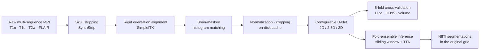

# Pediatric Brain Tumor Tissue Segmentation with a Configurable 2D/3D U-Net

An end-to-end deep-learning pipeline for segmenting the four tumor tissues of pediatric brain tumors on multi-sequence MRI (BraTS-PEDs). It covers:
- **MRI preprocessing:** skull stripping, rigid orientation alignment, and brain-masked histogram matching.
- **Training:** one U-Net, written from scratch in PyTorch, that runs as 2D, 2.5D or 3D with optional attention mechanisms.
- **Evaluation and prediction:** subject-level cross-validation with BraTS metrics, and ensemble prediction on new subjects.



## The task

Pediatric brain tumors are the most common solid tumors in children. Measuring their sub-regions volumetrically needs accurate 3D segmentation, and drawing them by hand is slow and varies between readers. Each subject has four co-registered MRI sequences (`t1n`, `t1c`, `t2w`, `t2f`), and the model labels every voxel as one of:

| label | tissue | why it is hard |
|---|---|---|
| 1 | ET – enhancing tumor | thin rims; absent in about a third of subjects |
| 2 | NET – non-enhancing tumor | dominant class (~74 % of tumor volume) |
| 3 | CC – cystic component | rare (~1 in 3 subjects); signal can resemble necrosis or edema |
| 4 | ED – peritumoral edema | rare (~1 in 5 subjects); diffuse, poorly defined borders |

Two composite regions are also evaluated: tumor core (TC = ET + NET + CC) and whole tumor (WT = all four labels). Because the tissues are so unevenly represented, sampling, the loss and the evaluation are designed around class imbalance (see below).

Data: BraTS-PEDs (the BraTS pediatric brain tumor challenge), available under the challenge's data-use terms. **No imaging data is included in this repository.**

## Preprocessing

### Skull stripping
[SynthStrip](https://synthstrip.io) runs in Docker, with a GPU image in `docker/synthstrip/`, and produces a brain mask from each subject's T1. The mask is applied to all four co-registered sequences.

### Rigid orientation alignment (`alignment.py`)
All volumes share one header (LPS, 240×240×155, 1 mm), but some heads are rotated *inside* the image grid. A head tipped by about 90° made the brain mask cut through the face and miss half of the tumor.
- Each subject's T1 is registered to a template subject: 6-DOF rigid, Mattes mutual information on percentile-clipped intensities inside a head mask, multi-resolution.
- The transform is applied to the four sequences (linear interpolation) and to the labels (nearest neighbour) on the original grid. Subjects below a rotation threshold are left untouched (hard-linked), so they are never interpolated unnecessarily.
- **Gross 90°/180° rotations are found visually.** Mutual information turned out to be unreliable for this: it often scored a wrongly flipped upright head higher than the correct orientation. So the pipeline generates contact sheets of every subject for a quick visual check, and passes the rotations found there as registration starting points. Registration then only does the fine alignment.
- The template is chosen from automatically ranked candidates: typical orientation, small tumor fully inside the brain mask, near-isotropic resolution (measured from per-axis gradient energy).
- Every resampled subject gets a before/after QC figure, and its rigid transform is saved so labels can be mapped the same way later.

### Brain-masked histogram matching (`histogram_matching.py`)
MRI intensities are not calibrated across scanners and sites. Each scan's intensity distribution is matched to the same sequence of a reference subject, **using only voxels inside the brain mask**, so zero background and skull/scalp don't distort the mapping. The reference is the training subject closest to the robust centre of the per-sequence mean, standard deviation, skewness and kurtosis. Before/after statistics and histogram figures are written for QC.

## Model: one U-Net, many configurations (`model.py`)

The network is a U-Net written directly in PyTorch. A single implementation handles 2D and 3D inputs; every component below is a configuration option:

| component | options |
|---|---|
| input | histogram-matched or raw (brain-masked, per-subject z-score); any subset of the four sequences |
| dimensionality | **3D** patches · **2D** slices along any axis · **2.5D** (neighbouring slices stacked as channels) |
| encoder / decoder blocks | plain or **residual**; instance / batch / group normalization; LeakyReLU / ReLU / GELU; dropout |
| down / up-sampling | strided convolution or max-pooling; transposed convolution or interpolation |
| channel / spatial attention | **squeeze-and-excitation** or **CBAM** inside every block |
| skip connections | optional **attention gates** (Attention U-Net), driven by the decoder features |
| bottleneck | convolutional · **transformer** (multi-head self-attention over all bottleneck voxels with convolutional positional encoding) · **ASPP** (parallel dilated convolutions + global context) |
| outputs | 5-class softmax, with optional **deep supervision** from the decoder's lower-resolution levels |

The default 3D model has 5 resolution levels (32→320 channels) and about 17 M parameters, and trains on 128³ patches.

## Training strategy (`training.py`, `datasets.py`, `losses.py`)

- **Imbalance-aware sampling.**
  - 3D patch centres are drawn per class with configurable ratios, so rare tissues appear in many more patches than their volume suggests.
  - In 2D, slices are drawn to contain a tissue chosen at random from those present in that subject.
- **Losses:** a region term (Dice or Tversky) plus a voxel term (cross-entropy or focal), with optional class weights. Under deep supervision the outputs are combined with weights 1, ½, ¼, …
- **Optimization:**
  - AdamW or SGD with Nesterov momentum; cosine or polynomial learning-rate schedule with warm-up; gradient clipping.
  - Fixed-length epochs of random patches (nnU-Net style).
- **Augmentation (MONAI):** random affine (rotation, scaling), flips on every axis, Gaussian noise, intensity scaling and shifting, gamma.
- **Efficiency:**
  - bf16/fp16 mixed precision.
  - Channels-last memory layout. This was the fix for a real problem: half-precision 3D convolutions in the default layout made cuDNN request a ~7 GB workspace for a single layer.
  - Preprocessed volumes are cached as memory-mappable `.npy` files, so 2D training reads single slices without loading whole volumes.
- **Robustness:** a checkpoint is saved every epoch, and interrupted runs resume exactly, including optimizer state, scheduler, best score and history. Finished folds are skipped. A run refuses to resume with a changed configuration.
- **Monitoring:** TensorBoard and CSV logs; periodic validation on the held-out fold.

## Evaluation (`folds.py`, `metrics.py`, `inference.py`)

- **Cross-validation:**
  - Subject-level 5-fold split on the labelled training subjects. Each subject has one scan, so no subject appears in two folds.
  - Folds are stratified by data source and by presence of the rare tissues, and saved once so every experiment uses the same split.
- **Metrics:**
  - Dice, 95th-percentile Hausdorff distance (HD95) and volume error, for each tissue and for TC/WT.
  - BraTS conventions for empty structures.
  - Dice is reported both over all subjects and over subjects where the tissue is present, because correctly predicting an absent rare tissue would otherwise inflate the mean.
- **Out-of-fold outputs:** every training subject receives a NIfTI prediction from the model that never saw it, plus per-subject metrics and per-fold summaries.
- **Inference:**
  - 3D uses Gaussian-weighted sliding windows; 2D/2.5D predicts slice by slice.
  - Optional flip test-time augmentation; averaging of the five fold models.
  - Predictions are restored to the original 240×240×155 grid and header.

## Installation

```bash
git clone https://github.com/Mohammadmasood1992/brats-peds-segmentation.git
cd brats-peds-segmentation
python -m venv .venv && source .venv/bin/activate          # or a conda environment
pip install torch --index-url https://download.pytorch.org/whl/cu128   # choose the build for your CUDA version
pip install -e ".[dev]"
pytest                                                      # model / metric / config tests (CPU, seconds)
```

Docker is needed for skull stripping (see `docker/synthstrip/README.md`).

## Usage

Place the data under `data/` (or point the paths in the configuration elsewhere):

```
data/
├── BraTS-PEDs_metadata.tsv
└── BraTS-PEDs-v1/{Training,Validation}/{case}/{case}-{t1n,t1c,t2w,t2f,seg}.nii.gz
```

```bash
# 1. brain masks
scripts/skullstrip_dataset.sh data/BraTS-PEDs-v1/Training data/BraTS-PEDs-v1/Validation

# 2. orientation alignment: visual screen, template ranking, registration + QC
python scripts/align_dataset.py screen --data-root data/BraTS-PEDs-v1
python scripts/align_dataset.py rank-templates --data-root data/BraTS-PEDs-v1
python scripts/align_dataset.py align --data-root data/BraTS-PEDs-v1 --output-root data/BraTS-PEDs-v1_rigid_aligned \
    --template <template case> --gross-rotation <case>:<rx>,<ry>,<rz>

# 3. brain-masked histogram matching
python scripts/histogram_match.py --data-root data/BraTS-PEDs-v1_rigid_aligned \
    --output-root data/BraTS-PEDs-v1_rigid_aligned_histmatched

# 4. cross-validated training (a two-minute end-to-end smoke test first)
python scripts/train_cv.py --config configs/3d_histmatched.yaml --smoke
python scripts/train_cv.py --config configs/3d_histmatched.yaml
python scripts/train_cv.py --config configs/3d_attention_transformer.yaml
python scripts/train_cv.py --config configs/2p5d_histmatched.yaml --set epochs=100 --set class_weights=auto

# 5. fold-ensemble prediction on new subjects, and scoring once labels exist
python scripts/predict.py --run-dir runs/3d_histmatched_conv \
    --input-root data/BraTS-PEDs-v1_rigid_aligned_histmatched/Validation --output-dir predictions/Validation
python scripts/evaluate.py --predictions predictions/Validation --label-root <labels in the aligned space>
```

Every option is documented in `DEFAULT_CONFIG` (`src/brats_peds_seg/config.py`). Experiment files in `configs/` list only what they change, `--set key=value` overrides single options, and unknown option names are rejected, so a typo can't silently fall back to a default.

Two narrated notebooks walk through the same steps with figures: `notebooks/01_preprocessing.ipynb` and `notebooks/02_segmentation.ipynb`.

## Repository structure

```
├── configs/                    experiment files (overrides of DEFAULT_CONFIG)
├── docker/synthstrip/          SynthStrip Docker image (GPU) and runner script
├── notebooks/                  01 preprocessing, 02 segmentation walk-through
├── scripts/                    command-line entry points
├── src/brats_peds_seg/
│   ├── config.py               options, label definitions, YAML loading
│   ├── alignment.py            rigid registration, orientation screen, template ranking, QC
│   ├── histogram_matching.py   brain-masked histogram matching
│   ├── folds.py                stratified subject-level folds
│   ├── preprocessing.py        normalization, cropping, on-disk cache
│   ├── datasets.py             imbalance-aware 2D/3D sampling and augmentation
│   ├── model.py                configurable U-Net (attention, transformer/ASPP bottlenecks)
│   ├── losses.py               Dice/Tversky + CE/focal with deep supervision
│   ├── metrics.py              Dice, HD95, volumes (BraTS conventions)
│   ├── training.py             cross-validation training loop with checkpoint/resume
│   ├── inference.py            sliding-window / slice inference, TTA, fold ensembles, NIfTI output
│   └── reporting.py            summaries, run comparison, plots, scoring of prediction folders
└── tests/                      unit tests for every model option, metrics and configuration
```

## Tech stack

PyTorch · MONAI · SimpleITK · nibabel · scikit-image · scikit-learn · NumPy/SciPy/pandas · Docker · TensorBoard · pytest

## Acknowledgements

- BraTS-PEDs data: Kazerooni et al., *The Brain Tumor Segmentation (BraTS) Challenge 2023: Focus on Pediatrics (CBTN-CONNECT-DIPGR-ASNR-MICCAI BraTS-PEDs)*, arXiv:2305.17033.
- Skull stripping: Hoopes et al., *SynthStrip: Skull-Stripping for Any Brain Image*, NeuroImage 2022.
- Attention gates: Oktay et al., *Attention U-Net*, 2018.
- CBAM: Woo et al., 2018.
- Squeeze-and-excitation: Hu et al., 2018.
- Sampling and training-schedule ideas follow nnU-Net (Isensee et al., Nature Methods 2021).

## License

MIT (see `LICENSE`). The BraTS-PEDs data are subject to their own data-use terms.
